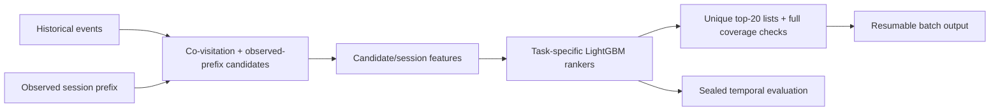

<div align="center">

# OTTO · Session-based recommendation

**Retrieve relevant items. Rank by intent. Verify every output.**


[](https://github.com/alvaromendizabal/otto-recommender-system/actions/workflows/ci.yml)
[](https://github.com/alvaromendizabal/otto-recommender-system/actions/workflows/reproduce.yml)

[**Interactive demo**](https://alvaro-otto-session-lab.tartmacaw2.chatgpt.site) · [**Architecture**](docs/ARCHITECTURE.md) · [**Model card**](docs/MODEL_CARD.md) · [**Run locally**](docs/QUICKSTART.md)

</div>

I built a session-based recommendation system for separate next-click, cart and purchase predictions. The retained work covers historical co-visitation, candidate/session features, objective-specific LightGBM ranking, temporal evaluation and resumable batch delivery.

## Results at a glance

| Evidence | Result | Measurement scope |
|:--|:--|:--|
| Historical processing scale | **216.7M training events** | Recorded research input, not live traffic |
| Validated batch output | **1.67M sessions / 5.02M rows** | One top-20 list for each of three objectives |
| Controlled feature study | **0.564904 → 0.584392 weighted Recall@20** | Same 432,492 temporal sessions; **+1.949 percentage points** |
| Retained scored release | **0.57586 private / 0.57601 public** | Post-competition evaluation; not an official rank or medal |

The controlled study and retained release use **different populations**. Neither establishes online business lift. The public reference uses the selected feature/ranking approach; the later delivered release also uses private similarity-feature and routing artifacts. [Exact scope](docs/PUBLICATION_SCOPE.md) · [Unchanged release receipt](reports/submissions/similarity_stack_20260925.json).


## What I owned

**The modeling path:** label-blind retrieval, candidate and session features, separate rankers for clicks/carts/orders, and complete top-20 validation. The controlled study screened 1,482 formulas into a 102-feature representation.

**The evaluation:** chronological fit/selection/evaluation roles, training-only feature screening, matched ablations, exact metric denominators and paired uncertainty. Candidate availability is measured separately from achieved ranking.

**The delivery:** streaming conversion, bounded materialization, source/model identities, exclusive-writer checkpoints, native model reloads and resumable prediction partitions.

## Retained architecture



The metric weights clicks 10%, carts 30% and orders 60%. Future targets never enter retrieval or scoring. [Inspect the source and tests](docs/ARCHITECTURE.md).

## Reproduce the public workflow

With Python 3.11+; no account, dataset or model download:

```bash
git clone https://github.com/alvaromendizabal/otto-recommender-system.git
cd otto-recommender-system
python3 -B -S review/run.py --output ../otto-review
python3 -B -S review/run.py --output ../otto-review --check
```

Open `../otto-review/index.html`. The native `reproduce.py review` path builds an authored 48-session walkthrough. An independent auditor reads its prediction/target exports and reconciles hits, ranking shortfalls and retrieval shortfalls. These **synthetic integration results are not competition performance**.

For real, small-scale training through the retained converter, retriever, feature engine and LightGBM evaluator:

```bash
uv sync --frozen --extra dev --extra ml
uv run --frozen --extra dev --extra ml python reproduce.py train --output artifacts/reference
uv run --frozen --extra dev --extra ml python reproduce.py train --output artifacts/reference
uv run --frozen --extra dev --extra ml python reproduce.py verify --output artifacts/reference
```

The second training invocation verifies and reuses completed artifacts. Full reference execution can use independently obtained training JSONL; it is plan-only until explicitly authorized. [Requirements and commands](docs/QUICKSTART.md).

## Review the implementation

| Question | Source | Verification |
|:--|:--|:--|
| How is the temporal population separated? | [Temporal corpus](src/otto_recsys/research/protocol.py) | [Protocol tests](tests/test_research_protocol.py) |
| How are candidates and features constructed? | [Retrieval](src/otto_recsys/research/retrievers.py) · [Features](src/otto_recsys/research/features.py) | [Retrieval tests](tests/test_research_retrieval.py) · [Feature tests](tests/test_research_features.py) |
| How are models selected and frozen? | [Training](src/otto_recsys/research/training.py) · [Study](src/otto_recsys/research/study.py) | [Training tests](tests/test_research_training.py) |
| How are delivered rows checked? | [Inference](src/otto_recsys/research/inference.py) | [Inference tests](tests/test_research_inference.py) |
| Can the reported feature gain be inspected? | [Executed controlled study](notebooks/09_controlled_feature_study.ipynb) | [Evidence checker](scripts/review_portfolio.py) |

## Release boundary

This is a completed offline ML portfolio project, not a deployed retail service. Public source, tests, the controlled notebook and compact final evidence are retained. Unused GPU retrievers, abandoned model branches, workspace launchers and dated experiment dumps are not part of the current project.

Private data, full prediction populations, trained private similarity artifacts, exact routing recipes and credentials remain excluded. The original project-specific AWS storage was decommissioned; public commands do not depend on it. Git history is retained, but historical branches are not supported execution paths.

**Alvaro Mendizabal · Machine Learning Engineer** · Python · Polars · LightGBM · temporal validation · reproducible ML systems.
