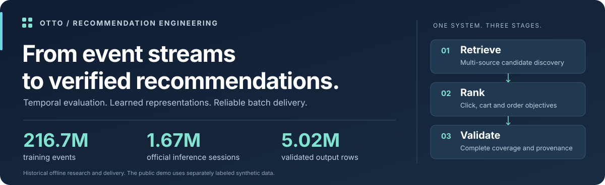
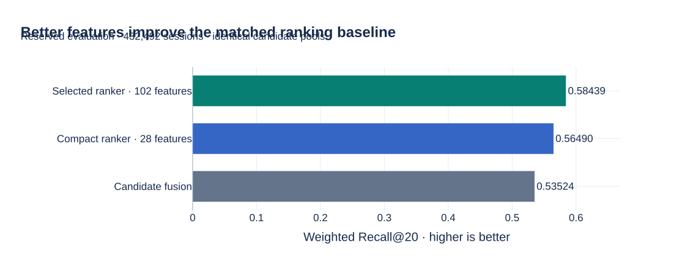
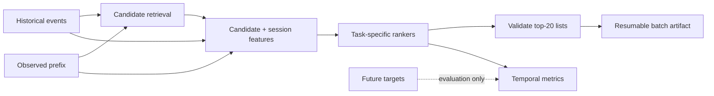

<div align="center">

> **Inspect the engineering:** [Source-linked review brief](review/README.md) · [Run the verified public checks](review/README.md#one-command-an-inspectable-result) · [Review-kit CI](https://github.com/alvaromendizabal/otto-recommender-system/actions/workflows/employer-review.yml)
> **Reproducibility assurance:** one command produces a review receipt that binds the public source inventory, runtime, executed checks and generated artifacts; exact reuse rejects changed imported code or fixtures.

# OTTO · Session-based recommendation



[](https://github.com/alvaromendizabal/otto-recommender-system/actions/workflows/ci.yml)
[](https://github.com/alvaromendizabal/otto-recommender-system/actions/workflows/reproduce.yml)
[](https://github.com/alvaromendizabal/otto-recommender-system/actions/workflows/public-demo.yml)

[**Employer overview**](docs/EMPLOYER_OVERVIEW.md) · [**Interactive demo**](https://alvaro-otto-session-lab.tartmacaw2.chatgpt.site) · [**Evidence map**](docs/EVIDENCE_MAP.md) · [**Five-minute review**](docs/REVIEWER_GUIDE.md)

</div>

I built a multi-stage recommender that turns short, anonymous shopping sessions into separate next-click, cart and purchase recommendations. My work spans event processing, candidate retrieval, feature research, task-specific ranking, neural similarity, temporal evaluation and verifiable batch delivery.

## 60-second overview

| Dimension | Evidence |
|:--|:--|
| **Scale** | **216.7M** training events · **1.67M** official inference sessions · **5.02M** validated output rows |
| **Representation** | **1,482** feature formulas screened into a **102-feature** controlled reference; specialized order ranking extends it |
| **Controlled study** | **0.584392 weighted Recall@20**, versus **0.564904** for the compact control on **432,492 temporal sessions** |
| **Recorded release** | **0.57586 private / 0.57601 public** · post-competition scoring, not an official rank or medal |
| **Engineering** | Sealed model choices, checksum-bound artifacts, resumable partitions, native-model replay, executed notebooks and CI |

The controlled study and release use **different populations**. Neither establishes online business lift. [Measurement definitions](docs/MODEL_CARD.md) · [Recorded release receipt](reports/submissions/similarity_stack_20260925.json).



## What I owned

**The recommendation system.** Multi-source retrieval, candidate/session features, click/cart/order rankers, routing and learned similarity. The architecture keeps candidate availability separate from achieved ranking and validates the complete output population.

**The scientific decisions.** Chronological fit/selection/evaluation roles, fitting-only feature screening, matched ablations, capped pooled metrics, uncertainty estimates and explicit rejection criteria. I preserve negative results instead of presenting every new model as an improvement.

**The delivery engineering.** Streaming conversion, process-level resource boundaries, immutable artifact identities, partition recovery, native-model checks, offline reports and publication safeguards. [Implementation walkthrough](docs/ARCHITECTURE.md) · [Detailed case study](docs/PORTFOLIO.md).

**Inspect the work behind the claims:** the [engineering evidence map](docs/EVIDENCE_MAP.md) links each design question to its implementation, tests and measured evidence.

## How the system works



The pooled metric weights clicks **10%**, carts **30%** and orders **60%**. Future targets remain outside retrieval and prediction. [Data and evaluation contract](docs/MODEL_CARD.md).

## Reproduce something real

**No accounts or dataset:** clone, then run the evidence audit and interactive synthetic walkthrough with Python 3.11+:

```bash
git clone https://github.com/alvaromendizabal/otto-recommender-system.git
cd otto-recommender-system
python3 -S reproduce.py review --output artifacts/review
```

Open the generated interactive report to inspect invented sessions, recommendations and score components. The demo is separate from the recorded research results. [Quickstart](docs/QUICKSTART.md).

<details>
<summary><strong>Go deeper: native model training and data-enabled reference research</strong></summary>

Install the locked Python 3.13 environment and run the small invented-data profile through the **actual** JSONL converter, historical retriever, feature engine, LightGBM ablations and temporal evaluator:

```bash
uv sync --frozen --extra dev --extra ml
uv run --frozen --extra dev --extra ml python reproduce.py train --output artifacts/reference
uv run --frozen --extra dev --extra ml python reproduce.py train --output artifacts/reference
uv run --frozen --extra dev --extra ml python reproduce.py verify --output artifacts/reference
```

The second training invocation verifies and reuses completed artifacts. The result includes native model files, a sealed temporal comparison, three top-20 lists per evaluation session, and an artifact manifest. **Its synthetic metrics are integration-test results, not the historical score.**

**Bring the official training data:** [Quickstart → full reference research](docs/QUICKSTART.md#full-reference-research) connects locally obtained JSONL to the published research protocol. It needs appropriate CPU, memory and disk—not access to my AWS account. The default is a resource plan; full execution requires explicit consent.

The public reference, small native replay and later neural-enhanced release are separate reproduction scopes. Exact reconstruction of the latter is **not** promised by a fresh clone. [Scope and prerequisites](docs/PUBLICATION_SCOPE.md).

</details>

## Two engineering lessons worth reviewing

**Better features mattered.** The selected representation improved the controlled reference by **1.949 percentage points**, with a paired session-bootstrap 95% interval of **1.840–2.065 points**. [Executed feature study](notebooks/09_controlled_feature_study.ipynb).

**Better candidate coverage was not enough.** A later orders retriever increased reachable hits from **2,556 to 2,600**. Its first reranking integration delivered **2,302** correct top-20 order hits against the incumbent's **2,326**, so it was rejected. This preserved the verified release rather than trading integrity for a favorable diagnostic. [Closeout and decision record](docs/RESEARCH_STATUS.md).

The earlier corrected click/cart challenger is **rejected** after replay against the actual deployed comparator. That validation-integrity case remains available alongside the later orders study. [Inspect the correction](research/frontier/11_validation_integrity_reconciliation.md).

## Review by interest

| Reviewer | Recommended path |
|:--|:--|
| **ML engineering** | [Architecture](docs/ARCHITECTURE.md) → [Decisions](docs/DECISIONS.md) → [Native reproduction](docs/QUICKSTART.md) |
| **Data science** | [Model card](docs/MODEL_CARD.md) → [Controlled study](notebooks/09_controlled_feature_study.ipynb) → [Research decisions](docs/RESEARCH_STATUS.md) |
| **Applied AI** | [Neural retrieval code](gpu/two_tower) → [Representation study](research/neural_stack) → [Release provenance](docs/INFERENCE.md) |
| **Hiring overview** | [Five-minute guide](docs/REVIEWER_GUIDE.md) → [Evidence map](docs/EVIDENCE_MAP.md) → [Employer overview](docs/EMPLOYER_OVERVIEW.md) |

## Project status

**Portfolio release complete; active experimental work concluded.** The October 12, 2026 closeout rechecked the previously submitted CSV's full checksum. It did not retrain models or claim a new score. Some private experimental caches were unavailable; their presence is not required for the new public reference workflow, but exact later-release reconstruction remains a documented limitation. [Sanitized closeout](reports/closeout/summary.json).

Existing notebooks, research modules, test suites, aggregate evidence and archived decisions remain available. Cloud-account identifiers in historical public metadata are replaced with placeholders; original-to-public byte changes are documented without exposing those identifiers. No credentials or owner-specific cloud setup are required for public reproduction. [Security and publication policy](docs/PUBLICATION_SCOPE.md).

**Stack:** Python · Polars · LightGBM · PyTorch · FAISS · AWS SageMaker/S3 · Plotly · pytest · GitHub Actions.
